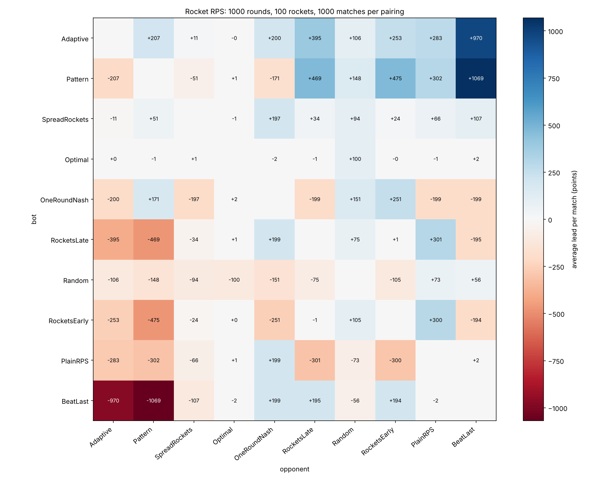
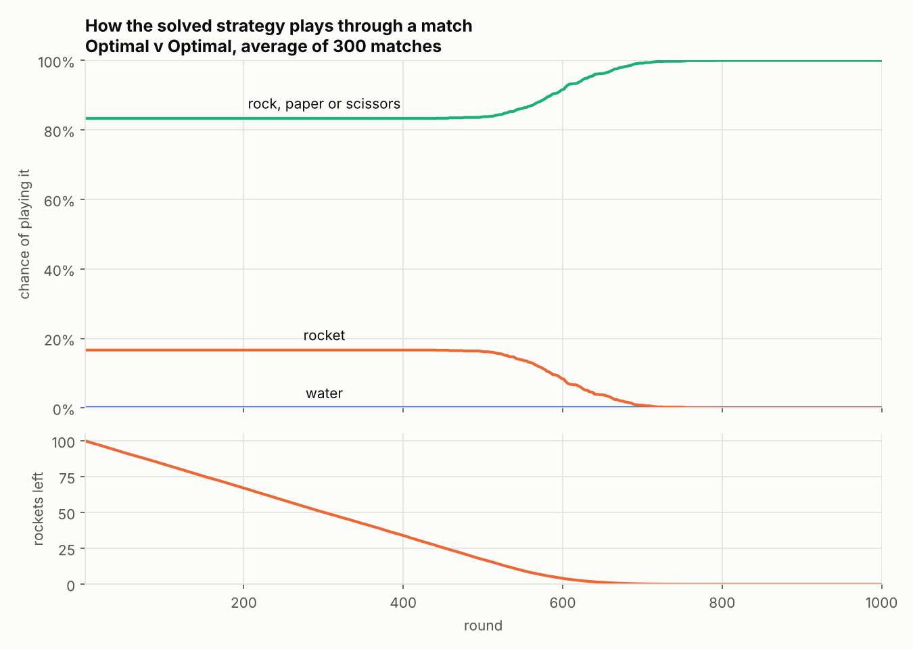
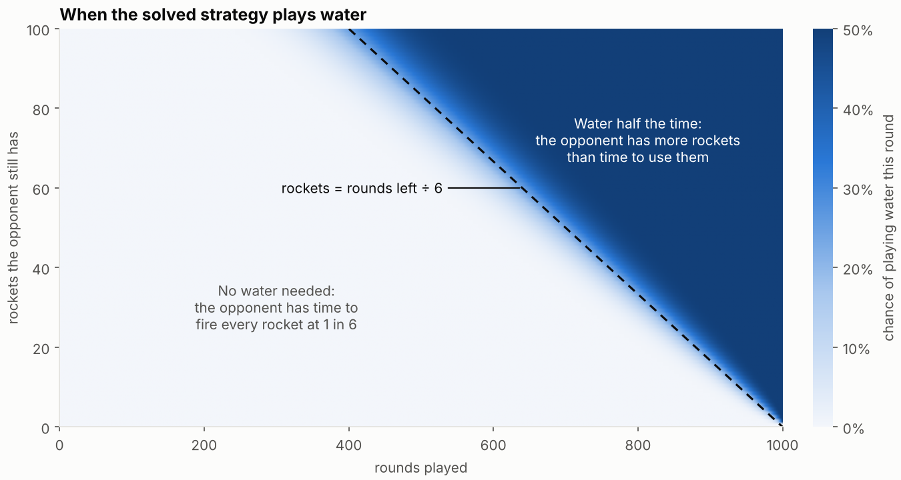
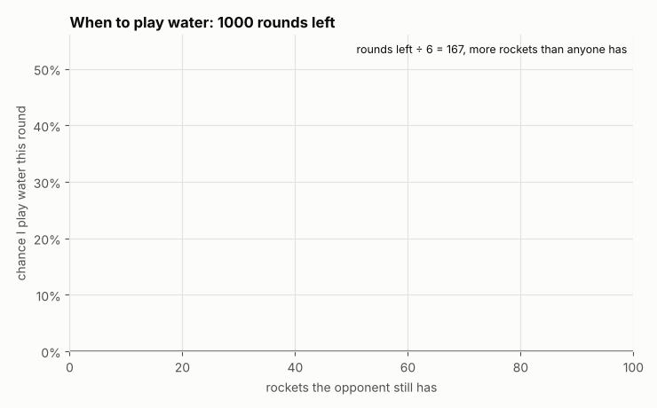
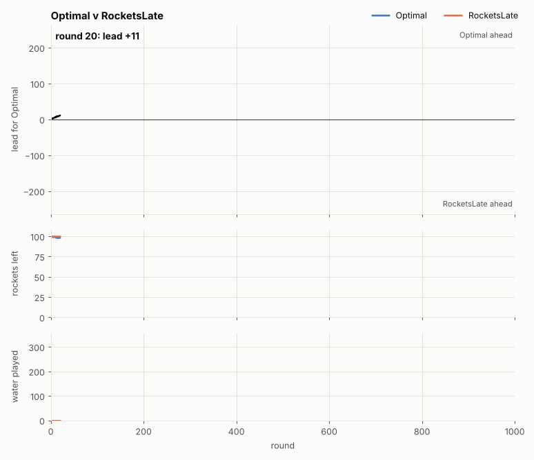

# Rocket RPS

Rock, paper, scissors with two extra moves, solved exactly, plus a set of bots
that play it against each other.

## The game

Two players play 1000 rounds, choosing at the same time each round.

| Move | Beats | Points for winning |
|---|---|---|
| Rock, paper, scissors | the usual move, and water | 1 |
| Rocket | rock, paper and scissors | 3 |
| Water | rocket | 2 |

- Each player has only **100 rockets**. Water is unlimited.
- Two identical moves score nothing.
- Both players can see how many rockets each has left.
- The player with the most points at the end wins.

The game is a variant of the "Rock Paper Scissors Boom" bot contest
([DevChatter/RockPaperScissorsBoom](https://github.com/DevChatter/RockPaperScissorsBoom)),
which has dynamite and water balloons but scores every win as 1 point. The
3 / 2 / 1 scoring here changes the optimal strategy.

## Quick start

```bash
pip install -r requirements.txt

python -m rocket_rps.tournament                   # full tournament, about 30 seconds
python -m rocket_rps.tournament --matches 1000 --jobs 4   # big run, about a minute
python -m rocket_rps.tournament --rounds 100 --rockets 10

python -m rocket_rps.play --lookup 300 70 50      # optimal strategy for one situation
python -m rocket_rps.play --bot Optimal --rounds 30 --rockets 3   # play a bot yourself

python -m pytest                                  # run the checks
```

The tournament prints a table of every pairing and a ranking, and saves
`ranking.csv`, `matrix.csv`, `matrix_std_error.csv`, `matches.csv` and
`heatmap.png` in `results/`.

## The bots

| Bot | Idea |
|---|---|
| **Optimal** | Plays the exact Nash equilibrium from the solver. Cannot be beaten on average. |
| **Adaptive** | Starts on the solved strategy, learns the opponent's habits, then exploits them while planning ahead with the solver's values. Goes back to the solved strategy if exploiting starts losing. |
| **Pattern** | Looks for patterns in the opponent's moves and plays the best move for this round only. |
| **OneRoundNash** | Plays the one-round equilibrium (rocket 1/6, water 1/2, others 1/9 each) every round, ignoring the future. |
| **SpreadRockets** | Spreads its rockets evenly over the match and plays water in proportion to the opponent's remaining rockets. |
| **RocketsEarly** | Fires a rocket every round until it runs out. |
| **RocketsLate** | Saves every rocket for the final rounds. |
| **BeatLast** | Plays whatever would have beaten the opponent's previous move. |
| **PlainRPS** | Ignores the special moves. |
| **Random** | Picks uniformly from the legal moves. |

Each bot's strategy is explained in detail in [BOTS.md](BOTS.md).

To add your own, subclass `Bot` in `rocket_rps/bots.py`, implement
`choose(view)`, and add it to `default_bots`.

## How the game is solved

A situation is three numbers: rounds left `n`, my rockets `r1`, their rockets
`r2`. Let `V(n, r1, r2)` be my expected final lead from there with best play
on both sides. Then `V(0, ·, ·) = 0` and each situation is a small zero-sum
game whose entries are

```
points this round + V(situation after the round)
```

The second term is what makes a rocket costly to fire: you land in a
situation with one fewer rocket. Working backwards from the last round
(backward induction, or dynamic programming) fills in all
1000 × 101 × 101 ≈ 10 million situations.

Rock, paper and scissors are interchangeable, so an optimal strategy always
plays them equally often. That turns each 5×5 game into a 3×3 game
(plain / rocket / water), which has a closed-form solution, so the whole game
is solved in about 15 seconds. The tests check this shortcut against solving
the full 5×5 game by linear programming (simplex).

Things the solution shows:

- With unlimited rockets the answer is rocket 1/6, water 1/2, and rock, paper,
  scissors 1/9 each.
- With limited rockets, a player holding rockets still fires 1/6 of the time.
  What changes is the **water** rate, which follows the threat: about 0 at the
  start of a match and up to 1/2 when the opponent's rockets are concentrated
  in the rounds that remain.
- The game is fair: `V = 0` when both players have the same number of rockets.

## Results

`results/` holds one run of the full game: 1000 rounds, 100 rockets and
**1000 matches per pairing** (45,000 matches, 45 million rounds). The ranking
by average lead per match:

| # | Bot | Average lead | ± error | Matches won |
|---|---|---|---|---|
| 1 | Adaptive | +269.4 | 0.3 | 90% |
| 2 | Pattern | +226.0 | 0.3 | 62% |
| 3 | SpreadRockets | +62.3 | 0.3 | 83% |
| 4 | Optimal | +11.0 | 0.3 | 55% |
| 5 | OneRoundNash | −46.7 | 0.4 | 39% |
| 6 | RocketsLate | −57.4 | 0.3 | 46% |
| 7 | Random | −72.3 | 0.4 | 22% |
| 8 | RocketsEarly | −88.0 | 0.3 | 35% |
| 9 | PlainRPS | −124.8 | 0.3 | 22% |
| 10 | BeatLast | −179.6 | 0.3 | 44% |

"± error" is one standard error. The true average is very likely within about
twice that of the number shown. To reproduce:
`python -m rocket_rps.tournament --matches 1000 --jobs 4` (about a minute).

How Optimal did against each opponent (average lead ± error):

| Opponent | Optimal's lead |
|---|---|
| Adaptive | +0.2 ± 0.9 |
| Pattern | −0.7 ± 1.1 |
| OneRoundNash | −1.8 ± 1.4 |
| SpreadRockets | +0.7 ± 0.8 |
| RocketsEarly | −0.3 ± 0.7 |
| RocketsLate | −0.6 ± 1.1 |
| BeatLast | +1.8 ± 1.0 |
| PlainRPS | −0.6 ± 0.8 |
| Random | +100.2 ± 1.0 |



What to notice:

- **Optimal never loses on average.** Against every bot except Random its
  lead is within about two standard errors of zero, which is what the theory
  predicts. It only wins clearly against Random, which wastes water and
  rockets.
- **Adaptive and Pattern win the tournament** by punishing predictable bots.
  BeatLast can be read perfectly, and loses by about 1000 points.
- **Pattern is exploitable itself.** Adaptive beats it by about 200, while
  Optimal holds it level. Adaptive is level with Optimal.
- **OneRoundNash loses to simple bots**, because it plays water half the time
  from the first round, when rockets are still rare.

So the solved strategy is the safest one, and a strategy that learns is the one
that wins a tournament of imperfect players.

## Graphs and GIFs

```
python -m rocket_rps.plots                         # everything, into figures/
python -m rocket_rps.plots --replay Optimal Random # one extra match replay
python -m rocket_rps.plots --no-gifs               # still images only
```

**The solved strategy through a match** (Optimal against Optimal, averaged over
300 matches). Both players fire rockets at 1/6 per round until they run out,
around round 600 to 700. Because the opponent is spending rockets just as fast,
the threat never builds up, and water is almost never played.



**When the solved strategy plays water.** The answer depends on only two
things: how many rockets the opponent still has, and how many rounds are left.
(My own rockets make no difference.) The dashed line is *rockets = rounds left
÷ 6*, the most rockets a player can expect to fire at 1 in 6 per round. Below
the line the opponent has time to use every rocket, so there is nothing to
defend against. Above it they are holding more than they can use, so they must
fire more often, and water goes up to half the time.



The GIF shows the same rule as a curve that slides left as the rounds run out.



**Match replays** show the lead, the rockets left and the water played, round
by round. Here RocketsLate saves all 100 rockets for the end, and Optimal
answers with water.



`figures/` also holds replays of Adaptive v RocketsLate, Pattern v BeatLast and
Adaptive v Pattern, each as a still image and a slow GIF (4 frames a second).

## Files

```
rocket_rps/game.py        rules, scoring and the match engine
rocket_rps/solver.py      exact solution by backward induction
rocket_rps/bots.py        the bots
BOTS.md                   how each bot's strategy works
rocket_rps/tournament.py  round-robin tournament, tables, CSV files, heatmap
rocket_rps/plots.py       strategy graphs, match replays and GIFs
rocket_rps/play.py        play a bot in the terminal, or look up one situation
tests/                    checks of the rules, the solver and the bots
results/                  output of one full tournament
figures/                  graphs and GIFs from plots.py
```
